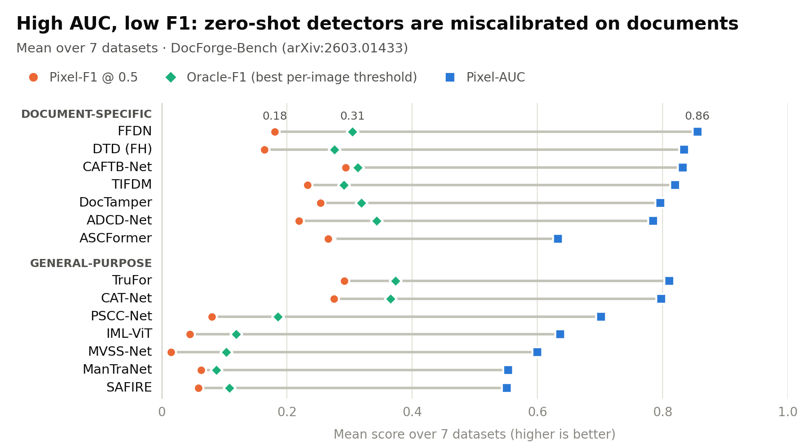

<div align="center">

# DocForge-Bench

### A Comprehensive Zero-Shot Benchmark for Document Forgery Detection and Analysis

Zengqi Zhao\*, Weidi Xia\*, En Wei\*, Yan Zhang\*, Jane Mo\*, Tiannan Zhang\*, Yuanqin Dai\*, Zexi Chen\*, Yiran Tao\*, Simiao Ren†

<sub>\* Equal contribution, order selected randomly · † Corresponding author</sub>

[](https://arxiv.org/abs/2603.01433)
[](LICENSE)
[](requirements.txt)


[**Paper**](https://arxiv.org/abs/2603.01433) · [**Results**](results/paper/main_results.csv) · [**Protocol**](docs/PROTOCOL.md) · [**Datasets**](docs/DATASETS.md) · [**Methods**](methods/README.md)

</div>

**14 forgery detectors, 8 document datasets, no fine-tuning.** Detectors that rank tampered
pixels well are badly calibrated on documents: at the default τ = 0.5 their Pixel-F1 is a
fraction of what their Pixel-AUC suggests, and close to zero for several general-purpose
methods. One threshold re-chosen on 10 in-domain images recovers much of the gap.

<p align="center">
  
</p>
<p align="center"><sub>Mean over the 7 datasets with all three metrics (MixTamper has no AUC column in the paper). For ASCFormer, F1@0.5 and Oracle-F1 are nearly equal, so the two markers overlap. Regenerate with <code>python scripts/make_readme_figure.py</code>.</sub></p>

## 📰 News

- **[2026/11]** Evaluation code, configs, pinned method setups and the paper's results released.
- **[2026/10]** arXiv v3 posted.
- **[2026/03]** Paper released on arXiv: [2603.01433](https://arxiv.org/abs/2603.01433).

## ✨ Key findings

- **A calibration gap, not a representation gap.** Methods reach moderate-to-high Pixel-AUC
  on documents, yet Oracle-F1 (best per-image threshold) is 2–10× their fixed-threshold
  Pixel-F1. Their scores rank tampered pixels correctly; τ = 0.5 is just the wrong cut-off.
- **The base rate explains it.** Tampered pixels are 0.27–4.17% of a document image,
  against the 10–30% typical of natural-image benchmarks that these detectors were tuned on.
- **Calibrating is cheap.** Choosing one threshold on N = 10 in-domain images recovers
  39–55% of the Oracle-F1 gap in the high-AUC cases we tested. Where scores are degenerate
  rather than shifted, calibration does not help.
- **No method works everywhere.** The best method changes from dataset to dataset, and
  models trained on DocTamper drop sharply on the other document datasets.

## 📊 Results

Pixel-F1 at τ = 0.5, zero-shot (paper, Table 4). **Bold** = best per dataset.

| Method | Type | DocTamper | T-SROIE | RTM | IC13 | Receipt | FantasyID | MixTamper | FSTS-1.5k |
|---|---|---|---|---|---|---|---|---|---|
| DocTamper | Doc | **0.914**‡ | 0.045 | 0.035 | **0.185** | 0.015 | 0.107 | 0.604 | 0.475 |
| DTD (FH) | Doc | 0.682‡ | 0.021 | 0.024 | 0.140 | 0.003 | 0.036 | 0.106 | 0.242 |
| FFDN | Doc | 0.736‡ | 0.043 | 0.025 | 0.156 | 0.019 | 0.068 | 0.072 | 0.219 |
| CAFTB-Net | Doc | 0.893‡ | 0.048 | 0.039 | 0.170 | 0.023 | 0.213 | 0.676 | **0.671** |
| TIFDM | Doc | 0.742‡ | 0.046 | 0.042 | 0.164 | 0.019 | **0.300** | 0.312 | 0.320 |
| ASCFormer | Doc | 0.180 | **0.779** | **0.265**‡ | 0.022 | **0.260** | 0.222 | 0.314 | 0.133 |
| ADCD-Net | Doc | 0.762‡ | 0.176 | 0.064 | 0.115 | 0.043 | 0.057 | 0.331 | 0.320 |
| TruFor | General | 0.154 | 0.664 | 0.095 | 0.108 | 0.203 | 0.296 | 0.689 | 0.522 |
| MVSS-Net | General | 0.012 | 0.002 | 0.004 | 0.059 | 0.002 | 0.002 | 0.142 | 0.025 |
| PSCC-Net | General | 0.134 | 0.002 | 0.004 | 0.046 | 0.015 | 0.046 | 0.470 | 0.316 |
| IML-ViT | General | 0.071 | 0.015 | 0.025 | 0.040 | 0.010 | 0.023 | 0.340 | 0.130 |
| SAFIRE | General | 0.102 | 0.016 | 0.021 | 0.093 | 0.009 | 0.044 | 0.387 | 0.124 |
| ManTraNet | General | 0.050 | 0.024 | 0.031 | 0.138 | 0.018 | 0.036 | 0.152 | 0.144 |
| CAT-Net | General | 0.672 | 0.274 | 0.042 | 0.038 | 0.234 | 0.155 | **0.695** | 0.512 |

<sub>‡ In-domain: the model was trained on this dataset's training split (TIFDM's training data is undisclosed; see the paper's Appendix B). RTM = RealTextManipulation, IC13 = Tampered-IC13, Receipt = ReceiptForgery. IML-ViT crops to 1024×1024, so most FantasyID forgeries fall outside its view.</sub>

Pixel-AUC, Oracle-F1 and Pixel-IoU for every pair are in
[`results/paper/main_results.csv`](results/paper/main_results.csv) and
[`results/full_metrics.csv`](results/full_metrics.csv); see [`results/README.md`](results/README.md).

## 🚀 Quick start

```bash
git clone https://github.com/BensonRen/document_forgery_benchmark.git
cd document_forgery_benchmark
python -m venv venv && source venv/bin/activate
pip install -r requirements.txt

bash scripts/setup_methods.sh        # clone the 11 upstream repos at the commits we evaluated
# add each method's pretrained weights: methods/README.md
# download and prepare the datasets:   docs/DATASETS.md

# score one method on one dataset
python scripts/run_exp2.py --config configs/exp2_doc_specific.yaml --method TruFor --datasets FSTS-1.5k
```

<details>
<summary><b>Full reproduction</b></summary>

```bash
# dataset preparation (after downloading each dataset from its authors)
python scripts/extract_doctamper_lmdb.py --lmdb-root data/DocTamper_lmdb --output-dir data/DocTamper
python scripts/generate_tsroie_masks.py --data-root data/T-SROIE --split test
python scripts/generate_bbox_masks.py --dataset receipt_forgery
python scripts/generate_bbox_masks.py --dataset tampered_ic13 --data_root data/Tampered-IC13
python scripts/generate_fantasyd_masks.py

# main benchmark: 14 methods x 7 datasets, then the FantasyID column
python scripts/run_exp2.py --config configs/exp2_doc_specific.yaml
python scripts/run_exp_fantasyd.py

# calibration experiment (one pair shown) and image-level detection
python scripts/run_calibration_exp.py --config configs/exp1_general_on_docs.yaml --method PSCC-Net --dataset FSTS-1.5k
python scripts/compute_image_metrics.py --all

# method validation on natural-image benchmarks (Appendix B)
python scripts/run_exp1.py --config configs/exp_validation.yaml
```

Run everything from the repository root. Each run writes `results/<E>/results.json`,
`results/<E>/results.csv` and per-image CSVs under `results/<E>/per_image/`. We used one
NVIDIA GPU with at least 24 GB of memory.

</details>

## 🧪 Protocol

| | |
|---|---|
| **Weights** | Each method's official pretrained weights. No fine-tuning, no threshold tuning. |
| **Images** | Official test splits. DocTamper, RTM and MixTamper are sampled to 1,000 images (`random.seed(42)`, then sorted). |
| **Scoring** | The prediction is resized to the mask (bilinear); maps over 2 MP are jointly downsampled to 2 MP (area interpolation). Metrics are computed per image, then averaged. |
| **Metrics** | Pixel-F1 and Pixel-IoU at τ = 0.5 · Pixel-AUC (threshold-free) · Oracle-F1: best F1 over 50 thresholds in (0, 1), per image. |
| **Authentic images** | Empty-mask images give NaN for pixel metrics and are left out of the dataset mean; they are still used for image-level AUROC. |

Every step, with the function that implements it: [`docs/PROTOCOL.md`](docs/PROTOCOL.md).

## 🧩 Methods and datasets

| General image forensics | Document-specific |
|---|---|
| TruFor · ManTraNet · MVSS-Net · CAT-Net · PSCC-Net · IML-ViT · SAFIRE | DocTamper (DTD) · DTD (ForensicHub) · FFDN · CAFTB-Net · TIFDM · ASCFormer · ADCD-Net |

**Datasets:** DocTamper · T-SROIE · RealTextManipulation · Tampered-IC13 · ReceiptForgery ·
FantasyID · MixTamper · FSTS-1.5k. They span synthetic and real forgeries, pixel and
bounding-box annotations, and formal documents, receipts, scene text and identity cards.

Methods run at the exact upstream commits we evaluated, with only small compatibility
patches. Methods that need a conflicting software stack run in their own conda environment
through a thin worker process ([`methods/README.md`](methods/README.md)). Datasets are not
redistributed; [`docs/DATASETS.md`](docs/DATASETS.md) lists sources and preparation steps.

## 📁 Repository layout

```
configs/      experiment configs: methods, datasets, sampling, output paths
scripts/      inference runners, metrics (evaluate.py), data preparation, analyses
methods/      pinned upstream commits, compatibility patches, inference wrappers
docs/         PROTOCOL.md (scoring, step by step) · DATASETS.md (sources and layout)
results/      the paper's numbers as CSV, full per-pair metrics, calibration, validation
assets/       README figure
```

<details>
<summary><b>Main scripts</b></summary>

| Script | Role |
|---|---|
| `scripts/evaluate.py` | Pixel-level metrics (Pixel-F1, Pixel-IoU, Pixel-AUC, Oracle-F1) and image-level metrics |
| `scripts/run_exp1.py` | Loaders for the 7 general methods; dataset loading and sampling; runs a config |
| `scripts/run_exp2.py` | Adds the 7 document-specific methods; runs the main benchmark |
| `scripts/run_exp_fantasyd.py` | Runs all methods on FantasyID |
| `scripts/run_calibration_exp.py` | Calibration experiment: per-image score histograms, N-image threshold calibration |
| `scripts/image_level_auroc.py`, `scripts/compute_image_metrics.py` | Image-level detection on the datasets that include authentic images |
| `scripts/global_opt_f1.py`, `scripts/calibration_full.py` | Single-global-threshold ceiling and calibration across all pairs |
| `scripts/compare_validation_results.py` | Checks each method against its published numbers |
| `scripts/setup_methods.sh` | Clones the upstream repos at pinned commits; installs patches and wrappers |

</details>

## 📝 Citation

If you find DocForge-Bench useful, please cite:

```bibtex
@article{zhao2026docforgebench,
  title   = {{DocForge-Bench}: A Comprehensive Benchmark for Document Forgery Detection and Analysis},
  author  = {Zhao, Zengqi and Xia, Weidi and Wei, En and Zhang, Yan and Mo, Jane and
             Zhang, Tiannan and Dai, Yuanqin and Chen, Zexi and Tao, Yiran and Ren, Simiao},
  journal = {arXiv preprint arXiv:2603.01433},
  year    = {2026}
}
```

## 🙏 Acknowledgements

This benchmark stands on the work of the authors of every method and dataset it
evaluates. We thank them for releasing their code, weights and data. In particular,
[ForensicHub](https://github.com/scu-zjz/ForensicHub) and
[IMDLBenCo](https://github.com/scu-zjz/IMDLBenCo) provide the document-model checkpoints
and the broader benchmarking context this work builds on.

## 📄 License and contact

The code in this repository is released under the [MIT License](LICENSE). Methods,
weights and datasets belong to their authors and keep their own licenses.

Questions and issues: open a GitHub issue, or contact Simiao Ren (benren@scam.ai).
